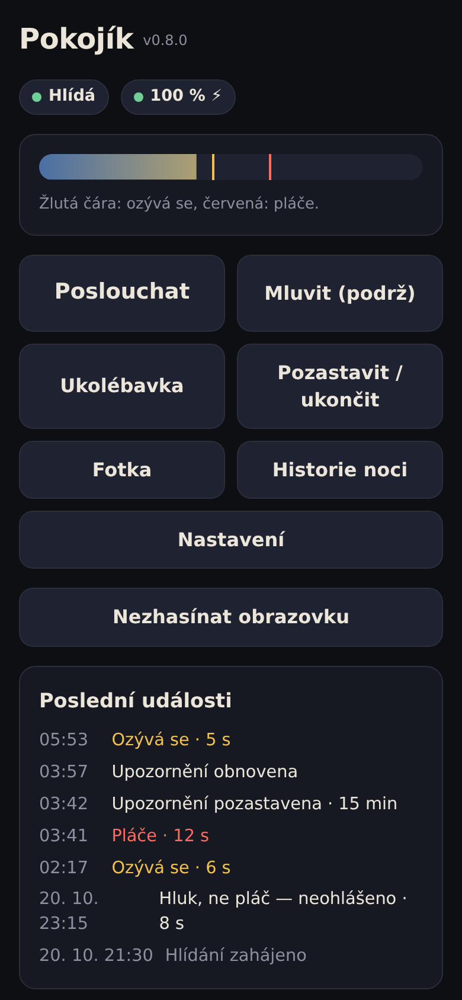
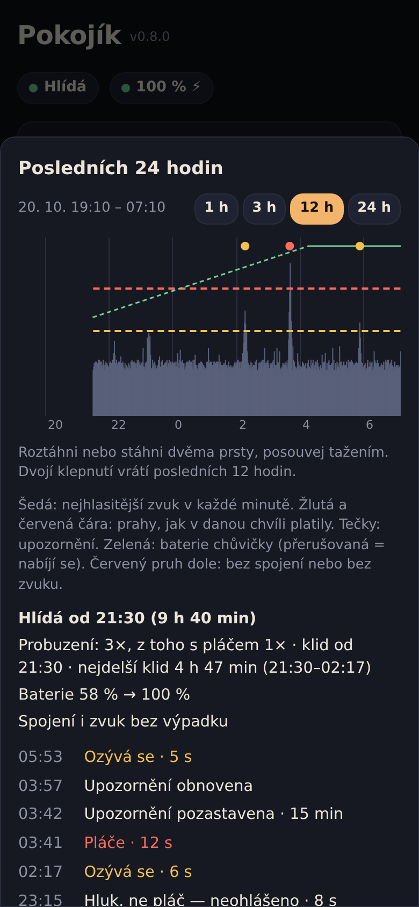
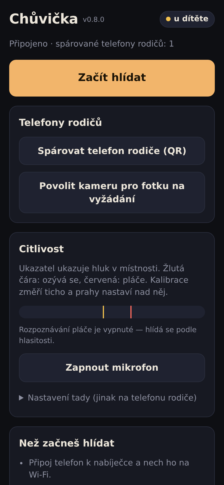
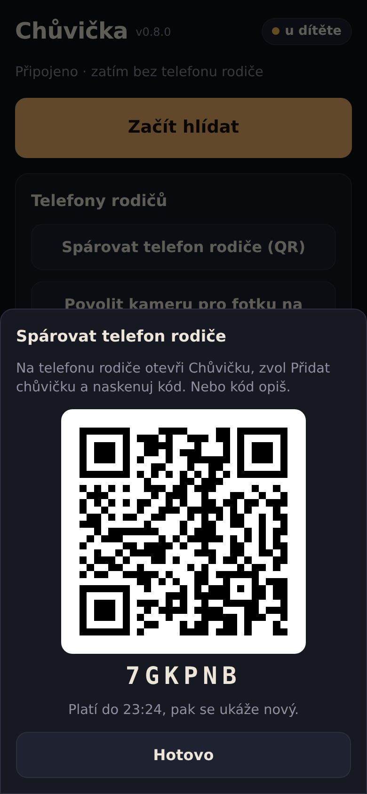
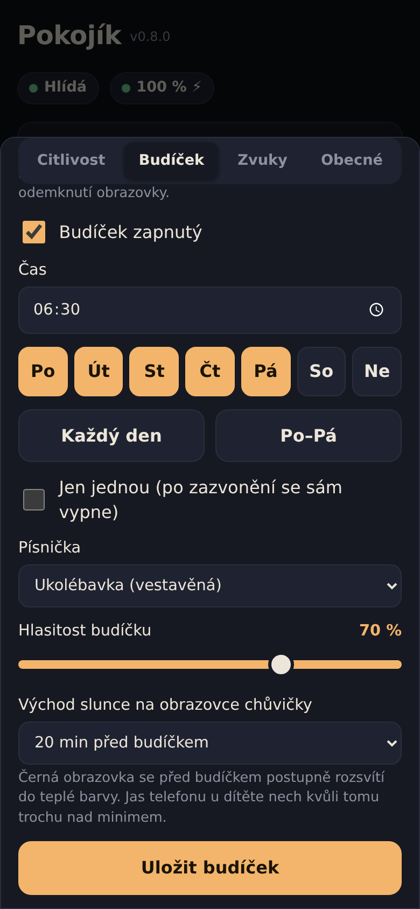

# Chůvička

[](https://github.com/toomaaseek/chuvicka-baby-monitor/actions/workflows/ci.yml)

*English: [README.md](README.md)*

Dětská chůvička ze dvou telefonů a vlastního malého serveru. Jeden telefon
leží v pokoji u dítěte a poslouchá, druhý má rodič. Ten dostane upozornění,
když se dítě ozývá nebo pláče, a může poslouchat, mluvit na dítě, pustit
ukolébavku nebo šum a ráno ho vzbudit budíčkem.

Je to webová aplikace (PWA). Nic se neinstaluje z obchodu, nejsou žádné
účty ani cizí cloud: telefony se spojují přes server, který si provozujete
sami.

Aplikace mluví česky a anglicky podle jazyka telefonu; přepnout jde
v nastavení.

<table>
  <tr>
    <td align="center"><br><sub>Telefon rodiče</sub></td>
    <td align="center"><br><sub>Historie noci</sub></td>
    <td align="center"><br><sub>Chůvička u dítěte</sub></td>
    <td align="center"><br><sub>Párování QR kódem</sub></td>
    <td align="center"><br><sub>Budíček</sub></td>
  </tr>
</table>

*Vymyšlená data, ne skutečná noc.*

## Co umí

- **Dvě úrovně upozornění:** *ozývá se* (tišší, delší zvuky) a *pláče*
  (hlasitě). Prahy a doby jdou nastavit, nebo chůvička změří ticho
  v pokoji a nastaví se sama.
- **Rozpoznání pláče přímo v telefonu** (na přání): než upozornění odejde, malý
  model (YAMNet od Googlu) posoudí poslední 3 sekundy. Řeč dospělých,
  hudba, televize, vysavač ani pes vás nevzbudí; když si model jistý
  není, upozornění odejde. Z telefonu nic neodchází.
- **Prahy podle stálého šumu:** ventilátor nebo šumítko zapnuté v noci
  prahy zvednou, místo aby spouštěly poplach.
- **Push upozornění** i na zamčený telefon rodiče, k tomu hlášení, když
  chůvička ztratí spojení, přestane slyšet nebo jí dochází baterie.
- **Příposlech** naživo a **vysílačka** (podržet a mluvit).
- **Ukolébavka a šum:** vestavěný bílý, růžový a hnědý šum a ukolébavka,
  nebo vlastní nahrané písničky. Na konci se ztiší.
- **Budíček:** zazvoní na chůvičce v nastavený čas, ve vybrané dny nebo
  jednou, s vlastní hlasitostí a volitelným **východem slunce**: obrazovka
  chůvičky se před budíčkem postupně rozsvítí do teplé barvy.
- **Historie noci:** graf hlasitosti za posledních 24 hodin (roztažení
  dvěma prsty, posun tažením) s prahy, upozorněními, baterií a výpadky,
  spánkový souhrn (probuzení, nejdelší klid) a seznam událostí.
- **Fotka na vyžádání:** chůvička na chvíli zapne kameru a pošle jeden
  snímek, ve tmě zesvětlený.
- **Pozastavení upozornění** na chvíli, nebo ukončení hlídání na dálku.
- Víc telefonů rodičů k jedné chůvičce i víc chůviček k jednomu rodiči.
- Párování jednorázovým QR kódem. Žádné účty ani e-maily.

## Soukromí

- Zvuk z mikrofonu se **nikam neukládá**. K rodiči jde jen ve chvíli,
  kdy poslouchá.
- Server drží hlasitost po minutách a události týden, pak je smaže.
- Ukládají se jen zvuky, které rodiče sami nahrají.
- Fotka na vyžádání zůstává jen v paměti serveru 5 minut, nikdy na disku.
- Rozpoznání pláče běží v telefonu u dítěte. Knihovna MediaPipe se snaží
  posílat Googlu anonymní statistiky používání; aplikace je zahodí
  a Content Security Policy stránky by je stejně zablokovala.
- Zařízení se prokazuje náhodným tajemstvím uloženým v telefonu.
  V databázi je jen jeho otisk SHA-256.

## Vyzkoušejte za 2 minuty

Na libovolném počítači s Dockerem, bez telefonů a bez HTTPS:

```sh
git clone https://github.com/toomaaseek/chuvicka-baby-monitor.git
cd chuvicka-baby-monitor
cp .env.example .env
docker compose -f docker-compose.example.yml up
```

Otevřete <http://localhost:8080> dvakrát: ve dvou různých prohlížečích,
nebo v normálním a anonymním okně (telefon si svou identitu pamatuje
v úložišti prohlížeče, dvě normální okna by byla tentýž telefon). Jedno
bude chůvička (použije mikrofon počítače), druhé rodič. Spárujte je kódem
a spusťte hlídání. Push upozornění potřebují klíče z kroku 2 níže,
všechno ostatní funguje.

## Co je potřeba

- Server s Dockerem (stačí Raspberry Pi), nebo Node.js 22.5 a novější.
- **HTTPS s platným certifikátem.** Mikrofon, push upozornění a service
  worker prohlížeče povolí jen na zabezpečené adrese. Použijte reverzní
  proxy (Caddy, nginx, Traefik) nebo tunel (Cloudflare Tunnel, Tailscale
  Funnel). Proxy musí pouštět WebSocket na `/ws`.
- Telefony s aktuálním prohlížečem: Chrome na Androidu, nebo Safari na
  iPhonu (iOS 16.4+). Na iPhonu musí být aplikace přidaná na plochu
  (Sdílet › Přidat na plochu), jinak upozornění nechodí.

## Spuštění přes Docker Compose

1. Stáhněte kód a připravte nastavení:

   ```sh
   git clone https://github.com/toomaaseek/chuvicka-baby-monitor.git
   cd chuvicka-baby-monitor
   cp .env.example .env
   ```

2. Vygenerujte klíče pro push upozornění a vložte je do `.env` spolu
   s kontaktní adresou (push služby ji vyžadují):

   ```sh
   docker run --rm node:22-alpine npx -y web-push generate-vapid-keys
   ```

   ```ini
   VAPID_PUBLIC_KEY=BK...
   VAPID_PRIVATE_KEY=...
   VAPID_SUBJECT=mailto:vy@example.com
   ```

   Soubor `.env` nikomu nedávejte. Když klíče později změníte, musí si
   každý rodič upozornění zapnout znovu.

3. Spusťte:

   ```sh
   cp docker-compose.example.yml docker-compose.yml
   docker compose up -d
   ```

   Stáhne se hotový obraz (amd64 i arm64, takže i Raspberry Pi). Kdo si
   ho chce sestavit sám, odkomentuje v compose `build: .` a přidá `--build`.

   Aplikace poslouchá na portu 8080 (v příkladu jen na `127.0.0.1`, takže
   na ni dosáhne jen reverzní proxy na stejném stroji).

4. Nasměrujte HTTPS proxy na `http://127.0.0.1:8080`. Pro Caddy:

   ```
   chuvicka.example.cz {
       reverse_proxy 127.0.0.1:8080
   }
   ```

   Pro nginx nezapomeňte na hlavičky pro WebSocket:

   ```nginx
   location / {
       proxy_pass http://127.0.0.1:8080;
       proxy_http_version 1.1;
       proxy_set_header Upgrade $http_upgrade;
       proxy_set_header Connection "upgrade";
       proxy_set_header X-Real-IP $remote_addr;
       proxy_read_timeout 1h;
   }
   ```

   Pak nastavte `CHUVICKA_IP_HLAVICKA=x-real-ip` (za Cloudflare
   `cf-connecting-ip`), ať limit pokusů o spárování počítá skutečné
   adresy. Bez proxy nechte prázdné: hlavičce poslané klientem věřit
   nejde.

5. Otevřete adresu na obou telefonech. Na jednom zvolte *U dítěte*, na
   druhém *U rodiče* a spárujte je QR kódem.

### Bez Dockeru

```sh
npm ci --omit=dev
npm run model   # stáhne model YAMNet pro rozpoznání pláče (4 MB)
VAPID_PUBLIC_KEY=... VAPID_PRIVATE_KEY=... VAPID_SUBJECT=mailto:vy@example.com \
  node --disable-warning=ExperimentalWarning server.js
```

Data jdou do `data/` vedle `server.js`, pokud nenastavíte `DB`.

## Nastavení

| Proměnná | Výchozí | Význam |
| --- | --- | --- |
| `VAPID_PUBLIC_KEY`, `VAPID_PRIVATE_KEY` | — | Klíče pro push upozornění. Bez nich aplikace funguje, jen upozornění nechodí. |
| `VAPID_SUBJECT` | — | Kontakt pro push služby, `mailto:` nebo `https:`. Bez něj upozornění nechodí. |
| `PORT` | `8080` | Port HTTP. |
| `DB` | `data/chuvicka.db` (v Dockeru `/data/chuvicka.db`) | Soubor databáze SQLite. |
| `ZVUKY` | `zvuky/` vedle databáze | Složka nahraných zvuků. |
| `CHUVICKA_MAX_ZVUK_MB` | `20` | Největší nahraný zvuk. |
| `CHUVICKA_MAX_ZVUKY_MB` | `200` | Všechny nahrané zvuky dohromady. |
| `CHUVICKA_IP_HLAVICKA` | — | Hlavička s adresou klienta od reverzní proxy, např. `x-real-ip` nebo `cf-connecting-ip`. |
| `CHUVICKA_HESLO` | — | Heslo pro přidání nového telefonu. Telefon rodiče, který otevře QR kód chůvičky, ho nepotřebuje. Doporučené pro server dostupný z internetu. |

## Zálohy a aktualizace

Všechno je ve svazku `chuvicka-data`: databáze a nahrané zvuky. Záloha:

```sh
docker compose cp chuvicka:/data ./zaloha-$(date +%F)
```

Aktualizace:

```sh
docker compose pull && docker compose up -d
```

(Při vlastním sestavení: `git pull && docker compose up -d --build`.)

Otevřené telefony novou verzi poznají a nabídnou načtení. Server
nerestartujte, když chůvička hlídá: rodiči by přišlo „Chůvička
neodpovídá", než se znovu připojí (obvykle během pár sekund).

## Dobré vědět

- **Jeden server je pro jednu rodinu**, nebo pro lidi, kteří si věří.
  Bez `CHUVICKA_HESLO` může telefon zaregistrovat kdokoli, kdo zná
  adresu. K chůvičce se tím nedostane (spárování chce jednorázový kód
  z chůvičky), ale uvidí nahrané zvuky, které jsou společné pro všechny
  telefony na serveru. S heslem přidá telefon jen ten, komu ho dáte.
- Chůvička musí mít aplikaci otevřenou se zapnutou obrazovkou (aplikace
  ji drží černou a zamčenou proti dotykům). Patří na nabíječku. Aby ji
  dítě nezavřelo: Připnutí aplikace (Android) nebo Asistovaný přístup
  (iPhone).
- Chůvička přes Wi-Fi není zdravotnický prostředek. Nespoléhejte na ni
  tam, kde by zmeškané upozornění bylo nebezpečné.

## Vývoj

Aplikace se nesestavuje: `public/` se posílá tak, jak je (ES moduly),
server je jeden `server.js` se SQLite z `node:sqlite`.

Testy (Node.js 22.5+):

```sh
npm test
```

Test v prohlížeči pouští dva telefony s napodobeným mikrofonem proti
běžícímu serveru. Potřebuje Playwright s Chromiem a adresu `localhost`
(zabezpečený kontext):

```sh
npm i --no-save playwright && npx playwright install chromium
node test/prohlizec.mjs http://localhost:8080
```

Překlady: klíčem je český text v kódu, anglický slovník je
`public/js/texty-en.js`. `npm test` neprojde, když překlad chybí.

## Bezpečnost

Viz [SECURITY.md](SECURITY.md): co aplikace chrání, na co si dát pozor
a jak nahlásit zranitelnost.

## Licence

[MIT](LICENSE)

Rozpoznání pláče používá [MediaPipe Tasks Audio](https://www.npmjs.com/package/@mediapipe/tasks-audio)
a model [YAMNet](https://ai.google.dev/edge/mediapipe/solutions/audio/audio_classifier),
obojí od Googlu pod licencí Apache 2.0. Model se stahuje při sestavení,
v repozitáři není.
