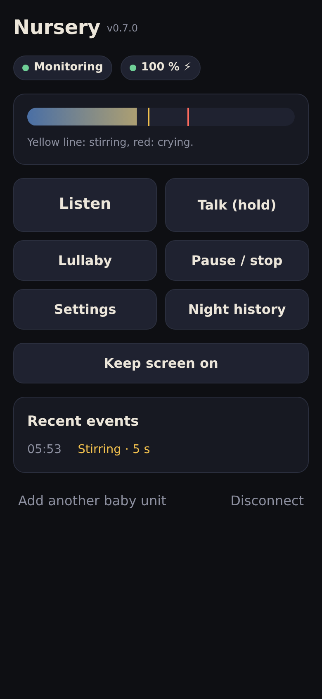
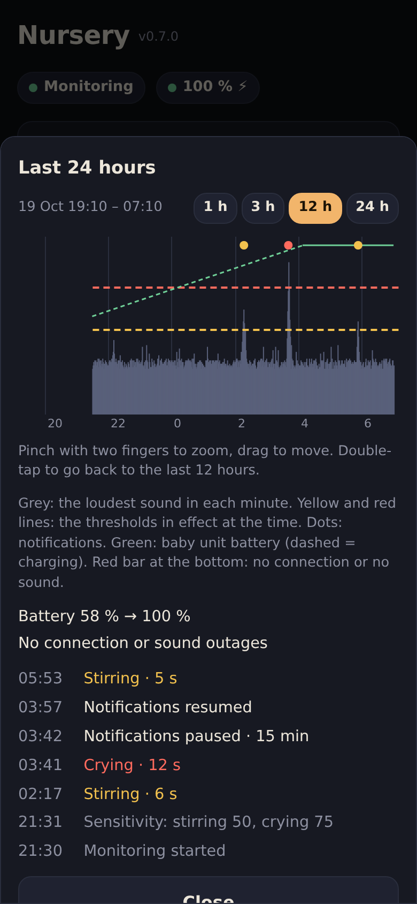
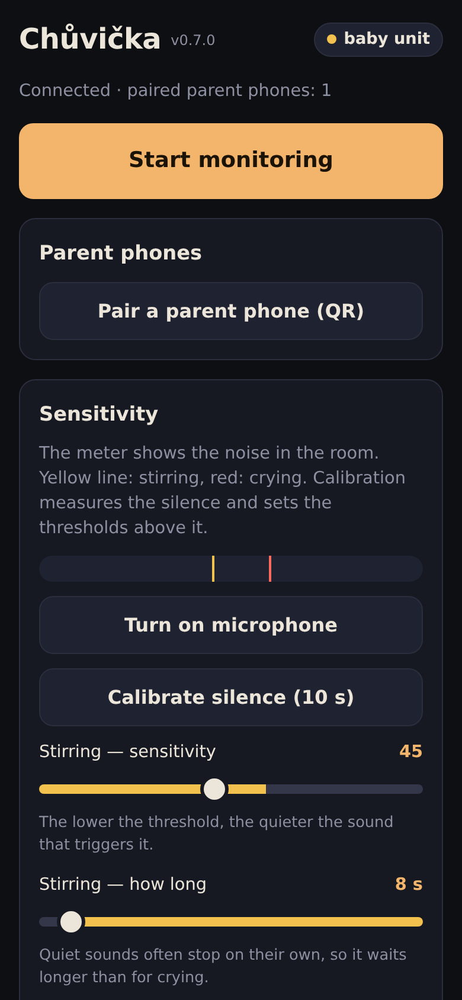
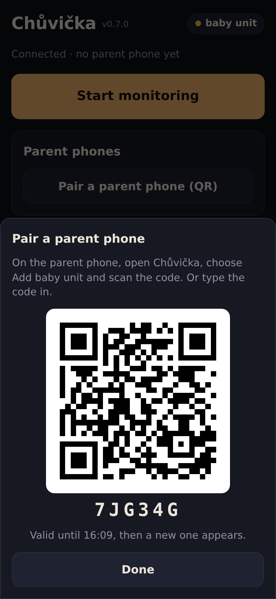
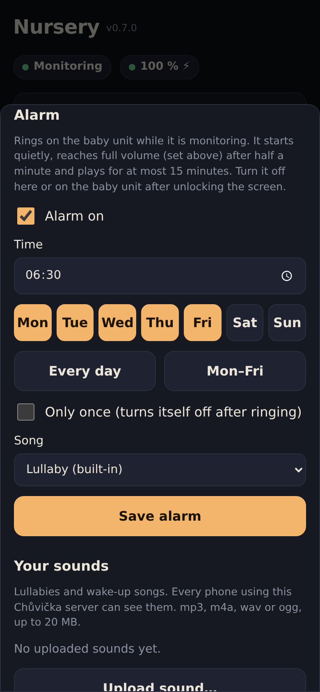

# Chůvička

*Čeština: [README.cs.md](README.cs.md)*

A baby monitor made of two phones and your own small server. One phone
stays in the baby's room and listens; the other one belongs to the parent.
It gets a push notification when the baby stirs or cries and can listen in,
talk to the baby, play a lullaby or white noise and ring a morning alarm.

It is a web app (PWA). Nothing to install from a store, no accounts and no
cloud service in between: the phones talk to a server you run yourself.

**Chůvička** is Czech for a baby monitor (and a nanny). The app speaks
English and Czech and follows the phone's language; there is a switch in
the settings.

<table>
  <tr>
    <td align="center"><br><sub>Parent phone</sub></td>
    <td align="center"><br><sub>Night history</sub></td>
    <td align="center"><br><sub>Baby unit</sub></td>
    <td align="center"><br><sub>Pairing with a QR code</sub></td>
    <td align="center"><br><sub>Alarm</sub></td>
  </tr>
</table>

*Example data, not a real night.*

## Features

- **Two levels of alerts:** *stirring* (quiet, longer sounds) and *crying*
  (loud). Thresholds and durations are adjustable, or let the baby unit
  calibrate itself to the silence of the room.
- **Push notifications** even when the parent phone is locked, plus alerts
  when the baby unit goes offline, its microphone stops or its battery
  runs low.
- **Listen in** live and **talk** to the baby (hold to talk).
- **Lullaby and noise:** built-in white, pink and brown noise and a
  lullaby, or your own uploaded songs. Fades out at the end.
- **Alarm:** rings on the baby unit at a set time, on chosen days or once.
- **Night history:** a graph of the sound level over the last 24 hours
  (pinch to zoom, drag to move) with thresholds, notifications, battery
  and outages, and a list of events.
- **Pause notifications** for a while, or stop monitoring remotely.
- Several parent phones per baby unit and several baby units per parent.
- Pairing with a one-time QR code. No accounts, no e-mail addresses.

## Privacy

- Audio from the microphone is **never stored**. It only travels to a
  parent phone while that parent is listening.
- The server keeps the sound level per minute and the events for one week,
  then deletes them.
- The only files stored are the sounds parents upload themselves.
- Devices identify themselves with a random secret stored on the phone.
  The database keeps only its SHA-256 hash.

## Requirements

- A server that can run Docker (a Raspberry Pi is enough), or Node.js 22.5
  or newer.
- **HTTPS with a valid certificate.** Browsers allow the microphone, push
  notifications and service workers only on secure origins. Use a reverse
  proxy (Caddy, nginx, Traefik) or a tunnel (Cloudflare Tunnel, Tailscale
  Funnel). The proxy must pass WebSocket connections on `/ws`.
- Phones with a current browser: Chrome on Android, or Safari on iPhone
  (iOS 16.4+). On iPhone, the app must be added to the Home Screen
  (Share › Add to Home Screen) to receive notifications.

## Running it with Docker Compose

1. Get the code and create the configuration:

   ```sh
   git clone https://github.com/toomaaseek/chuvicka-baby-monitor.git
   cd chuvicka-baby-monitor
   cp .env.example .env
   ```

2. Generate the keys for push notifications and put them into `.env`
   together with a contact address (push services require one):

   ```sh
   docker run --rm node:22-alpine npx -y web-push generate-vapid-keys
   ```

   ```ini
   VAPID_PUBLIC_KEY=BK...
   VAPID_PRIVATE_KEY=...
   VAPID_SUBJECT=mailto:you@example.com
   ```

   Keep `.env` private. If you change the keys later, every parent phone
   has to turn notifications on again.

3. Start it:

   ```sh
   cp docker-compose.example.yml docker-compose.yml
   docker compose up -d --build
   ```

   The app listens on port 8080 (bound to `127.0.0.1` in the example, so
   only the reverse proxy on the same machine can reach it).

4. Point your HTTPS reverse proxy to `http://127.0.0.1:8080`. For Caddy:

   ```
   babymonitor.example.com {
       reverse_proxy 127.0.0.1:8080
   }
   ```

   For nginx, include the WebSocket upgrade headers:

   ```nginx
   location / {
       proxy_pass http://127.0.0.1:8080;
       proxy_http_version 1.1;
       proxy_set_header Upgrade $http_upgrade;
       proxy_set_header Connection "upgrade";
       proxy_set_header X-Real-IP $remote_addr;
       proxy_read_timeout 1h;
   }
   ```

   Then set `CHUVICKA_IP_HLAVICKA=x-real-ip` (with Cloudflare:
   `cf-connecting-ip`) so the limit on pairing attempts counts real client
   addresses. Leave it empty when there is no proxy in front of the app:
   a header sent by a client cannot be trusted.

5. Open the address on both phones. Choose *With the baby* on one and
   *With the parent* on the other, then pair them with the QR code.

### Without Docker

```sh
npm ci --omit=dev
VAPID_PUBLIC_KEY=... VAPID_PRIVATE_KEY=... VAPID_SUBJECT=mailto:you@example.com \
  node --disable-warning=ExperimentalWarning server.js
```

Data goes to `data/` next to `server.js` unless you set `DB`.

## Configuration

| Variable | Default | Meaning |
| --- | --- | --- |
| `VAPID_PUBLIC_KEY`, `VAPID_PRIVATE_KEY` | — | Keys for push notifications. Without them the app works, but no notifications are sent. |
| `VAPID_SUBJECT` | — | Contact for push services, `mailto:` or `https:`. Required for notifications. |
| `PORT` | `8080` | HTTP port. |
| `DB` | `data/chuvicka.db` (`/data/chuvicka.db` in Docker) | SQLite database file. |
| `ZVUKY` | `zvuky/` next to the database | Folder for uploaded sounds. |
| `CHUVICKA_MAX_ZVUK_MB` | `20` | Largest uploaded sound. |
| `CHUVICKA_MAX_ZVUKY_MB` | `200` | All uploaded sounds together. |
| `CHUVICKA_IP_HLAVICKA` | — | Header with the client address set by your reverse proxy, e.g. `x-real-ip` or `cf-connecting-ip`. |

## Backup and updates

Everything lives in the `chuvicka-data` volume: the database and the
uploaded sounds. To copy it out for a backup:

```sh
docker compose cp chuvicka:/data ./backup-$(date +%F)
```

To update, pull the new code and rebuild:

```sh
git pull
docker compose up -d --build
```

Open phones notice the new version and offer to reload. Don't restart the
server while the baby unit is monitoring: the parent would get a
"baby unit offline" alert until it reconnects (usually within seconds).

## Good to know

- **One server is for one family** or a group of people who trust each
  other. Anyone who can reach the address can register a phone, but that
  alone gives no access to any baby unit: pairing needs a one-time code
  shown on the baby unit. Uploaded sounds, however, are shared by all
  phones on the server, and any paired parent can delete them.
- The baby unit has to keep the app open with the screen on (the app keeps
  the screen black and locked against touches). Keep it on a charger.
  To stop a child from leaving the app, use App pinning (Android) or
  Guided Access (iPhone).
- A monitor on Wi-Fi is not a medical device. Don't rely on it where a
  missed alert would be dangerous.

## Development

The app has no build step: `public/` is served as is (ES modules), the
server is a single `server.js` with SQLite from `node:sqlite`. The code
and comments are in Czech.

Tests (Node.js 22.5+):

```sh
npm test
```

The browser test runs two phones with a simulated microphone against a
running server. It needs Playwright with Chromium and a `localhost`
address (a secure context):

```sh
npm i --no-save playwright && npx playwright install chromium
node test/prohlizec.mjs http://localhost:8080
```

Translations: the Czech text in the code is the key, the English
dictionary is `public/js/texty-en.js`. `npm test` fails when a translation
is missing.

## License

[MIT](LICENSE)
